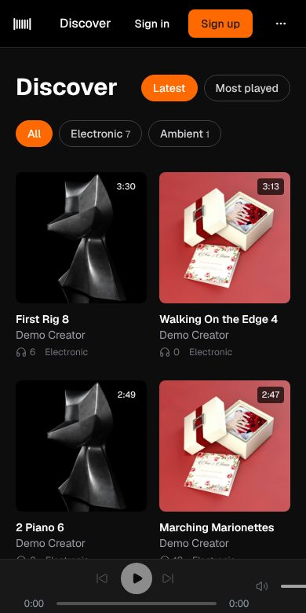
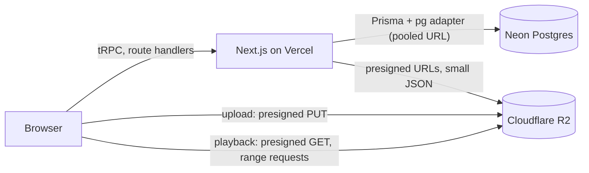
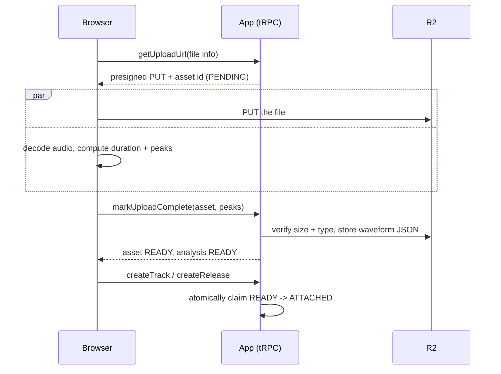
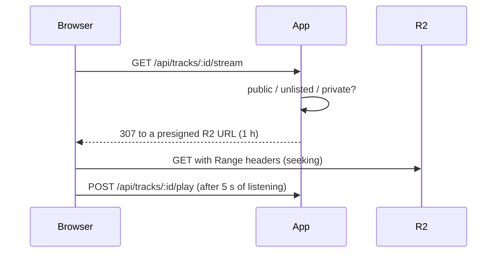

# Music Stream

A SoundCloud-style platform for sharing music: creators upload tracks, listeners browse, search and stream them with live waveforms.
One Next.js app on **Vercel**, **Neon** Postgres and **Cloudflare R2**.

**Live demo:** https://music-stream-app-2025.vercel.app
&nbsp;·&nbsp; [](https://github.com/HyperGrapher/music-stream-app-2025/actions/workflows/ci.yml)


<table>
  <tr>
    <td width="50%"></td>
    <td width="50%"></td>
  </tr>
  <tr>
    <td width="50%"></td>
    <td width="50%" align="center"></td>
  </tr>
</table>

## What works today

- **Accounts:** email + password (verification email, password reset, common-password check) and Google sign-in ([Better Auth](https://www.better-auth.com)); onboarding (username, avatar, genres, creators to follow); settings for profile, email, password, connected accounts, sessions, privacy and account deletion. Unverified accounts can listen and like but not upload or comment.
- **Profiles and follows:** `/{username}` with All, Popular tracks, Tracks, Albums, Playlists, Reposts, Likes, Followers and Following as real pages (infinite scroll), Spotlight, links, follow/unfollow with exact counters, and a "Who to follow" module.
- **Uploading:** MP3, WAV, OGG, FLAC, AAC or M4A up to 100 MB, straight from the browser to R2, with per-file progress (Queued, Uploading, Analysing, Verifying, Ready) and retry. A single track with the full metadata editor, or several files as an album/EP/single/compilation with a drag-and-drop track list, bulk actions and a warning when a public release contains private tracks. A file the browser cannot decode is rejected. Free accounts have 180 minutes of upload time.
- **Editing:** edit any track or collection later (permalink changes keep the old link working), reset secret links, replace the audio file (Pro), delete with a summary of what goes with it.
- **Plans (demo):** Free and Pro with a no-payment upgrade page; Pro unlocks scheduled releases, Quiet Mode and audio replacement.
- **Permalinks:** every account gets a lowercase username; tracks live at `/{username}/{slug}` and collections (album, EP, single, compilation, playlist) at `/{username}/sets/{slug}`. Old `/track/{id}` and `/u/{id}` URLs redirect.
- **Visibility and secret links:** public, private (owner only) or scheduled tracks (a Pro feature, evaluated at read time). Private tracks and collections open for anyone holding their secret link (`/…/s-{token}`), and nowhere else.
- **Image processing:** uploaded images (JPEG, PNG, WebP up to 10 MB) are centre-cropped and stored as WebP renditions with [sharp](https://sharp.pixelplumbing.com): artwork 96/320/640 px, avatars 64/160/320 px (square), banners 1240/2480 px wide (2480x520 strip); the original is deleted. Every `` gets a `srcset` and `sizes`.
- **Waveforms without a media server:** the browser decodes the file (Web Audio) while it uploads and computes the duration and waveform peaks. The server validates them and stores a small JSON next to the audio.
- **Streaming:** seeking works, audio never passes through the app server, and visibility (including secret links) is enforced.
- **Player:** one global player with shuffle, repeat, a "Next up" queue (play next / add to queue from any track menu), autoplay of related tracks, buffered range, keyboard shortcuts (press `?`), OS media controls (Media Session API), a mini player and full-screen sheet on phones, and a saved position that survives reloads.
- **Social loop:** reposts and likes for tracks, albums, playlists and comments, a Feed of the people you follow (de-duplicated reposts, "new posts" pill), notifications (bell, grouped, per-type in-app and email preferences, daily digest, one-click unsubscribe), and a Library (likes, playlists, albums, following, listening history).
- **Trust and safety:** report tracks, albums, playlists, comments and people; block people (they can't follow you or comment, and you stop seeing their comments); an admin area for the report queue, removing or restoring content, suspending accounts and an audit log.
- **Creator Studio:** a table of all your tracks and collections with sorting, filters and bulk edit/delete, Insights (plays over time, top tracks; Pro adds longer ranges, countries, sources, top listeners and per-track views), a Spotlight editor, and the Free/Pro limits enforced on the server.
- **Playlists, sharing, embeds, downloads:** create playlists from the add-to-playlist dialog; share dialog with start-time links (`#t=1m23s`), social intents and an embed code (`/embed/track/{id}`, `/embed/set/{id}`); signed-in downloads when the creator allows them.
- **Search and discovery:** Postgres full-text search with typo tolerance (navbar autocomplete and a `/search` page with tabs and filters), a personalised Home and "Made for you", charts (Top 50, New & Hot, per genre), tag and genre pages, recommendations from your likes, plays and follows, and one-click stations.
- **Browsing:** `/discover` (latest or most played, genre filter, infinite scroll), creator profiles, track pages and collection pages.
- **Timed comments:** comment at the exact second you are listening to (read from the player at the moment you post), with one level of replies. Each timed comment shows as an avatar under the waveform and as a clickable time chip that jumps the player there. Authors and the track's creator can delete.
- **Likes** on tracks (optimistic UI, safe against double clicks and races, rate limited; you cannot like your own or a private track), shown as filled hearts for the signed-in listener.
- **Play counts** that cannot be inflated by refreshing: one count per listener per track per 30 minutes; the owner's own plays are never counted. Daily statistics are kept for charts and insights.
- **Platform plumbing:** Postgres-backed rate limiter, email module (Resend, or logged when no key is set), durable R2 deletion queue with a daily cron, simulated Free/Pro entitlements, injectable clock.

**Work in progress:** the product is being built out milestone by milestone against [`docs/PRD.md`](docs/PRD.md) (M0 to M7 done; status in [`docs/REFACTOR.md`](docs/REFACTOR.md)). The data model already contains reposts, blocks, notifications, reports, messages and insights tables, but their UI and procedures arrive in later milestones: direct messages and a final polish pass are still to come.

## How it works



**Upload** — the audio bytes never touch the app server:



**Playback** — visibility is checked, then the browser talks to R2 directly:



### Decisions worth knowing

| Decision | Why |
| --- | --- |
| One Next.js app, no separate API server | Separate `*.vercel.app` projects are different sites, so auth cookies break, and serverless functions cannot hold sockets. |
| Audio is never proxied; the app redirects to short-lived presigned R2 URLs | Keeps audio off Vercel bandwidth, gets range requests for free, and still enforces private/unlisted access. |
| Waveforms are computed in the browser | FFmpeg/audiowaveform do not fit serverless limits. The trade-off: peaks are client-supplied, so a creator could fake their own waveform (validated for shape and length). |
| Media is a first-class model: `MediaAsset` goes `PENDING -> READY -> ATTACHED` | Uploads can be verified, cleaned up when abandoned, and claimed atomically so two requests cannot publish the same file. |
| One `Collection` model (playlist, album, EP, single, compilation); private + secret link instead of "unlisted"; scheduling evaluated at read time | See [ADR 0002](docs/adr/0002-collections-secret-links-and-read-time-scheduling.md). One reviewed visibility module decides who sees what everywhere. |
| R2 deletions go through a durable queue (`StorageDeletion`) | A lost `after()` or a failed delete is retried by the daily cron; shared demo media is protected. |
| Play counts are deduped with an HMAC of IP + user agent and a Postgres advisory lock | No raw IPs stored, and concurrent requests cannot double count. |
| Comments store `timestampSeconds` (whole seconds) read from the player when the user posts; writes are serialised per track with an advisory lock | `Track.commentCount` always equals the number of rows, even when a thread is deleted while replies arrive. Replies are one level deep and carry no timestamp. |
| Images are stored as WebP renditions per purpose (artwork 96/320/640, avatar 64/160/320, banner 1240/2480) and the original is deleted | Renditions cover the largest box each image appears in on a 2x screen. Keeping only what the UI can show keeps R2 small; the trade-off is that larger sizes cannot be regenerated later. |
| `Track.likeCount` changes only when a `TrackLike` row is really inserted or deleted, in the same transaction | A denormalised counter that cannot drift from the rows, however often or concurrently the button is pressed. |
| Prisma 7 with the `pg` adapter on Neon's pooled URL; migrations use the direct URL | Pooling for serverless traffic, a real connection for `migrate`. |

The domain language is in [`CONTEXT.md`](CONTEXT.md), the schema rationale in [`docs/adr/`](docs/adr/0001-normalized-media-and-content-relations.md), and the full engineering log (what was decided, tried and verified, session by session) in [`docs/REFACTOR.md`](docs/REFACTOR.md).

## Stack

Next.js 16 (App Router, Turbopack) · React 19 · TypeScript · tRPC 11 · Prisma 7 · Neon Postgres · Cloudflare R2 (S3 API) · Better Auth · Tailwind 4 + shadcn/ui · Zustand · zod 4 · Playwright · GitHub Actions · pnpm.

## Project layout

```
src/
  app/                      routes: pages ((player)/[username], [trackSlug], sets/[slug]), route handlers
                            (api/auth, api/trpc, api/cron/daily, api/images/[assetId], api/tracks/[id]/{stream,waveform,artwork,play})
  components/               shared UI (upload flow, shadcn/ui)
  server/
    api/                    tRPC routers (collections, comments, discover, engagement, profiles, tracks, upload)
    modules/                domain logic: visibility, tracks (authorize, dto, likes, comments, plays), publishing,
                            collections, profiles, plans (entitlements), rate-limit, email, storage (deletion queue),
                            media (image pipeline), housekeeping (daily cron), stats, recount
    clock.ts                injectable clock
  lib/                    auth, R2 client, names (usernames/slugs), genres, waveform + audio analysis, helpers
  store/                    player and upload state (Zustand)
prisma/                     schema, migrations, seed scripts
tests/{integration,e2e}/    DB-backed tests and Playwright
scripts/deps/               automatic dependency update tooling
```

## Run it locally

Requirements: Node 22+, pnpm 10, a Postgres database, and (for uploads and playback) a Cloudflare R2 bucket.

```bash
pnpm install                # also generates the Prisma client
cp .env.example .env        # fill in the values below
pnpm db:migrate             # apply migrations
pnpm db:seed                # optional: a demo world (users, tracks, albums, playlists, plays); see SEED_README.md
pnpm dev                    # http://localhost:3000
```

| Variable | Purpose |
| --- | --- |
| `DATABASE_URL` | Postgres URL the app uses (on Neon: the pooled `-pooler` URL) |
| `DATABASE_URL_UNPOOLED` | Direct URL for `prisma migrate` (optional locally; on Neon the non-pooled URL) |
| `BETTER_AUTH_SECRET` | Random secret, e.g. `openssl rand -base64 32` |
| `BETTER_AUTH_URL` | Public base URL, e.g. `http://localhost:3000`. Must be `https` in production: it determines the Google OAuth redirect URI |
| `GOOGLE_CLIENT_ID`, `GOOGLE_CLIENT_SECRET` | Google OAuth client; register `<BETTER_AUTH_URL>/api/auth/callback/google` as a redirect URI |
| `R2_ACCOUNT_ID`, `R2_ACCESS_KEY_ID`, `R2_SECRET_ACCESS_KEY`, `R2_BUCKET_NAME` | R2 credentials and bucket |
| `R2_PUBLIC_BASE_URL` | Optional public bucket URL for images; without it images are served through presigned redirects |
| `RESEND_API_KEY`, `EMAIL_FROM` | Optional. Without a key every email is stored as `LOGGED` in `email_message` and printed to the server log |
| `ADMIN_EMAILS` | Optional, comma-separated emails that get the ADMIN role when they sign in |
| `CRON_SECRET` | Bearer secret of `/api/cron/daily` (`vercel.json` schedules it once a day); the endpoint refuses callers without it |
| `NEXT_PUBLIC_APP_URL` | Optional absolute base URL for emails and meta tags (defaults to `BETTER_AUTH_URL`) |

Counters (likes, plays, followers, track counts, daily statistics) can be repaired from their source rows with `pnpm db:recount`.

The R2 bucket needs a **CORS rule** allowing `PUT` with the `Content-Type` header from each origin you upload from (`http://localhost:3000`, your production domain), otherwise browser uploads fail.

## Deploying (Vercel + Neon + R2)

1. Create the Neon project and the R2 bucket (with the CORS rule above) and a Google OAuth client.
2. Import the repo into Vercel and set the variables above (`DATABASE_URL` = pooled URL, `DATABASE_URL_UNPOOLED` = direct URL).
3. Deploy. `vercel-build` runs `prisma migrate deploy` **for production deployments only** (previews skip it, so an unmerged branch cannot change the shared database), then builds. `BETTER_AUTH_URL` is validated at build time and must be `https`.

## Tests, CI and dependency updates

| Command | |
| --- | --- |
| `pnpm check-types` / `pnpm lint` | TypeScript and ESLint (no warnings allowed) |
| `pnpm test` | unit tests (`node:test`, no database) |
| `pnpm test:integration` | DB-backed tests: publish races, rollbacks, visibility, discovery, play counting, likes, comments, auth. Needs `TEST_DATABASE_URL` pointing at a migrated, disposable Postgres |
| `pnpm test:e2e` | Playwright against a production build on a **wiped** `TEST_DATABASE_URL` database (`pnpm exec playwright install chromium` once) |

The opt-in `tests/e2e/upload-playback.e2e.spec.ts` runs the whole creator journey against real R2: upload, in-browser analysis, publish, play (`E2E_R2=1 E2E_PORT=3000 pnpm test:e2e`).

- [`ci.yml`](.github/workflows/ci.yml) runs everything above on every pull request and on `master`, on a throwaway Postgres service container, with no secrets, plus a check that the migrations match `schema.prisma`.
- [`dependency-updates.yml`](.github/workflows/dependency-updates.yml) runs daily: it tests each available update on its own with the same checks, then commits the combination that passed (or opens an auto-merge PR when `master` is protected). Updates that break the tests are reported in an issue and not retried until a newer version appears. Settings: [`scripts/deps/config.json`](scripts/deps/config.json).
