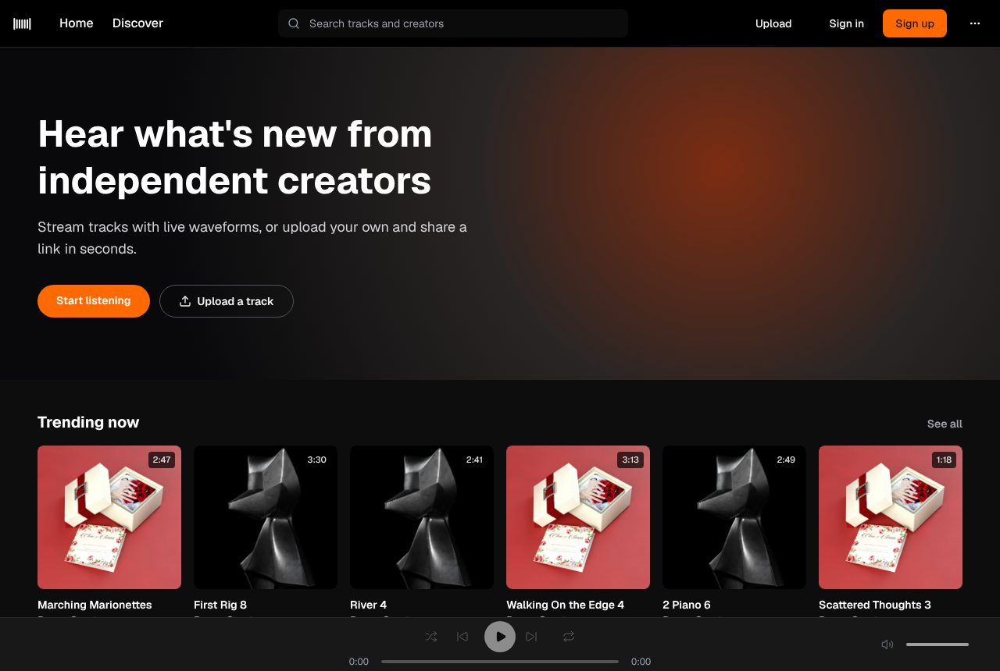
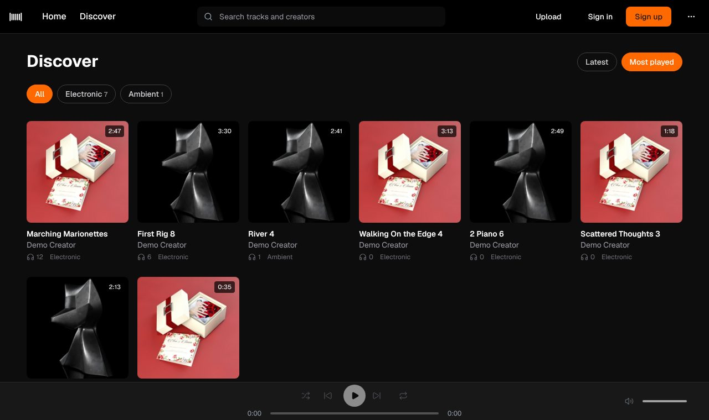
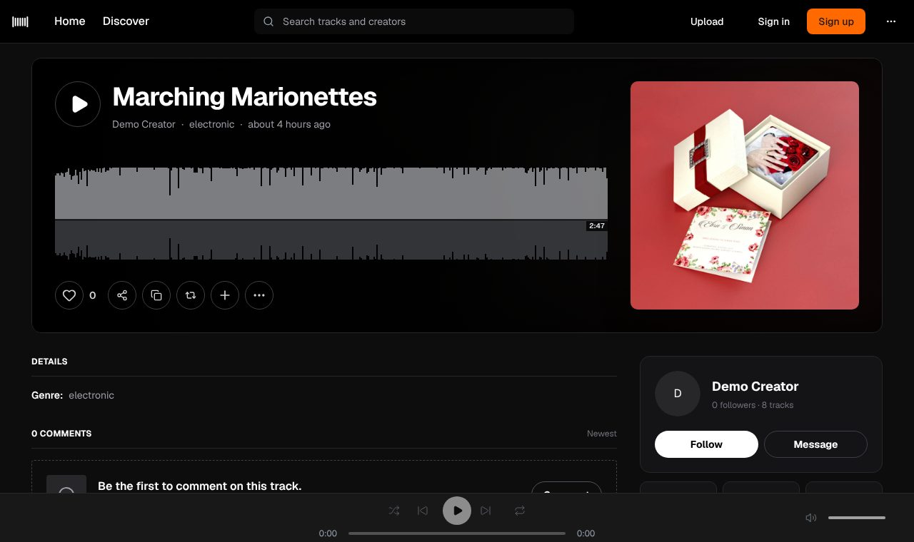
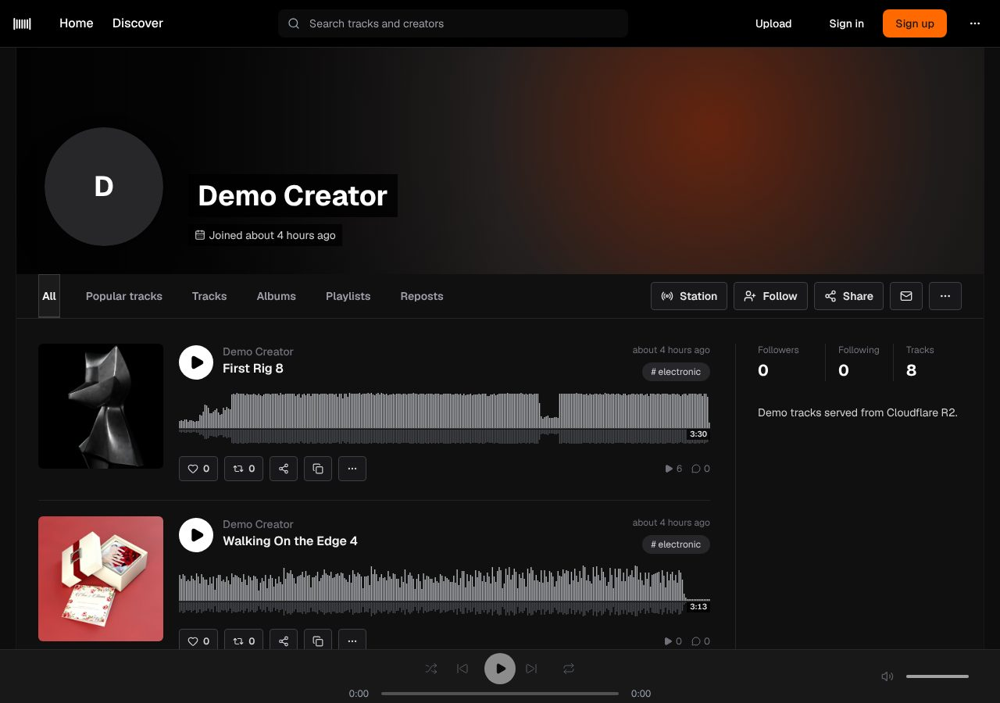
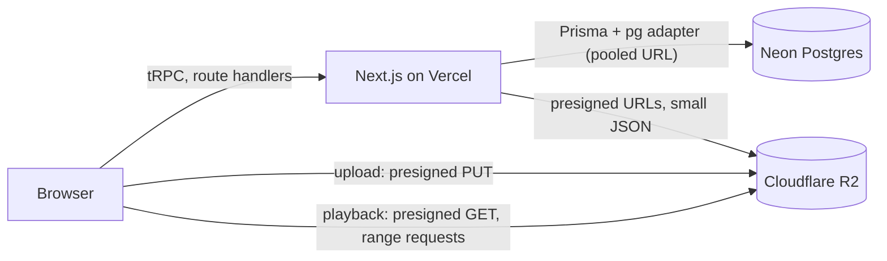
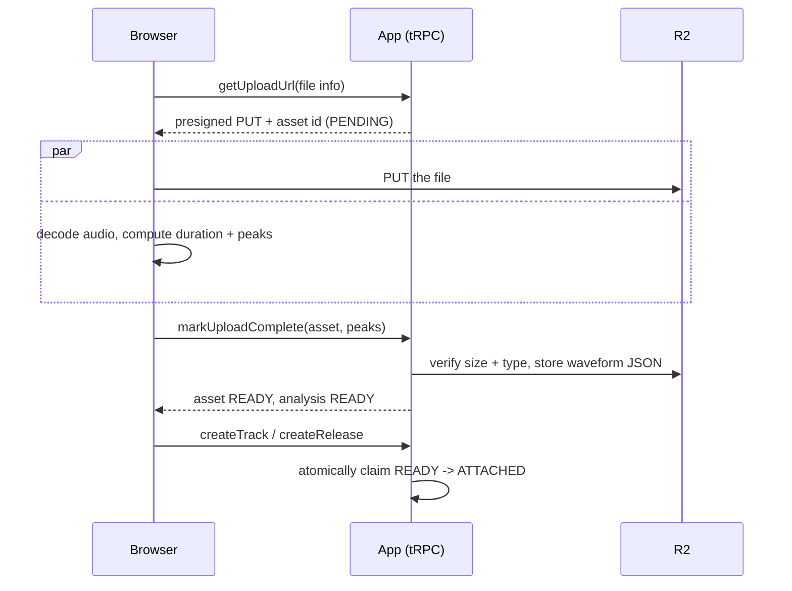
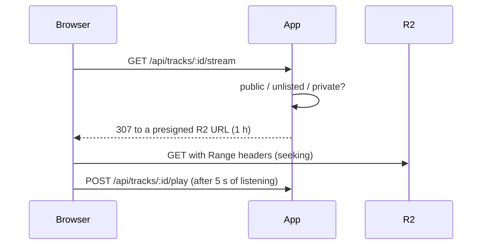

# Music Stream

A SoundCloud-style platform for sharing music: creators upload tracks, listeners browse, search and stream them with live waveforms.
One Next.js app on **Vercel**, **Neon** Postgres and **Cloudflare R2**.

**Live demo:** https://music-stream-app-2025.vercel.app
&nbsp;·&nbsp; [](https://github.com/HyperGrapher/music-stream-app-2025/actions/workflows/ci.yml)



<table>
  <tr>
    <td width="50%"></td>
    <td width="50%"></td>
  </tr>
  <tr>
    <td width="50%"></td>
    <td width="50%" align="center"></td>
  </tr>
</table>

## What works today

- **Accounts:** email + password and Google sign-in ([Better Auth](https://www.better-auth.com)).
- **Uploading:** MP3, WAV, OGG, FLAC, AAC or M4A up to 50 MB, straight from the browser to R2. A single track, or several files as an album/EP release with ordered tracks and shared artwork.
- **Waveforms without a media server:** the browser decodes the file (Web Audio) while it uploads and computes the duration and waveform peaks. The server validates them and stores a small JSON next to the audio.
- **Streaming:** seeking works, audio never passes through the app server, and public / private visibility is enforced.
- **Player:** one global player with a queue, next/previous, keyboard shortcuts and OS media controls (Media Session API).
- **Browsing:** a landing page, `/discover` (latest or most played, genre filter, search over titles and creator names), creator profiles and track pages.
- **Likes** on tracks (optimistic UI, safe against double clicks and races), shown as filled hearts for the signed-in listener.
- **Play counts** that cannot be inflated by refreshing: one count per listener per track per 30 minutes.

**Not built yet** (the controls exist in the UI, the backend models exist in the schema): reposts, comments, follows and playlists. There is also no "unlisted" option in the upload form yet, although the data model and the stream/page access rules already support it.

## How it works



**Upload** — the audio bytes never touch the app server:



**Playback** — visibility is checked, then the browser talks to R2 directly:



### Decisions worth knowing

| Decision | Why |
| --- | --- |
| One Next.js app, no separate API server | Separate `*.vercel.app` projects are different sites, so auth cookies break, and serverless functions cannot hold sockets. |
| Audio is never proxied; the app redirects to short-lived presigned R2 URLs | Keeps audio off Vercel bandwidth, gets range requests for free, and still enforces private/unlisted access. |
| Waveforms are computed in the browser | FFmpeg/audiowaveform do not fit serverless limits. The trade-off: peaks are client-supplied, so a creator could fake their own waveform (validated for shape and length). |
| Media is a first-class model: `MediaAsset` goes `PENDING -> READY -> ATTACHED` | Uploads can be verified, cleaned up when abandoned, and claimed atomically so two requests cannot publish the same file. |
| Play counts are deduped with an HMAC of IP + user agent and a Postgres advisory lock | No raw IPs stored, and concurrent requests cannot double count. |
| `Track.likeCount` changes only when a `TrackLike` row is really inserted or deleted, in the same transaction | A denormalised counter that cannot drift from the rows, however often or concurrently the button is pressed. |
| Prisma 7 with the `pg` adapter on Neon's pooled URL; migrations use the direct URL | Pooling for serverless traffic, a real connection for `migrate`. |

The domain language is in [`CONTEXT.md`](CONTEXT.md), the schema rationale in [`docs/adr/`](docs/adr/0001-normalized-media-and-content-relations.md), and the full engineering log (what was decided, tried and verified, session by session) in [`docs/REFACTOR.md`](docs/REFACTOR.md).

## Stack

Next.js 16 (App Router, Turbopack) · React 19 · TypeScript · tRPC 11 · Prisma 7 · Neon Postgres · Cloudflare R2 (S3 API) · Better Auth · Tailwind 4 + shadcn/ui · Zustand · zod 4 · Playwright · GitHub Actions · pnpm.

## Project layout

```
src/
  app/                      routes: pages, route handlers (api/auth, api/trpc, api/tracks/[id]/{stream,waveform,artwork,play})
  components/               shared UI (upload flow, shadcn/ui)
  server/
    api/                    tRPC routers (artist, discover, upload)
    modules/tracks/         domain logic: access rules, discovery queries, plays, waveform validation
  lib/                    auth, R2 client, waveform + audio analysis, helpers
  store/                    player and upload state (Zustand)
prisma/                     schema, migrations, seed scripts
tests/{integration,e2e}/    DB-backed tests and Playwright
scripts/deps/               automatic dependency update tooling
```

## Run it locally

Requirements: Node 22+, pnpm 10, a Postgres database, and (for uploads and playback) a Cloudflare R2 bucket.

```bash
pnpm install                # also generates the Prisma client
cp .env.example .env        # fill in the values below
pnpm db:migrate             # apply migrations
pnpm db:seed:r2             # optional: register the audio already in your R2 bucket as demo tracks (needs ffprobe)
pnpm dev                    # http://localhost:3000
```

| Variable | Purpose |
| --- | --- |
| `DATABASE_URL` | Postgres URL the app uses (on Neon: the pooled `-pooler` URL) |
| `DATABASE_URL_UNPOOLED` | Direct URL for `prisma migrate` (optional locally; on Neon the non-pooled URL) |
| `BETTER_AUTH_SECRET` | Random secret, e.g. `openssl rand -base64 32` |
| `BETTER_AUTH_URL` | Public base URL, e.g. `http://localhost:3000`. Must be `https` in production: it determines the Google OAuth redirect URI |
| `GOOGLE_CLIENT_ID`, `GOOGLE_CLIENT_SECRET` | Google OAuth client; register `<BETTER_AUTH_URL>/api/auth/callback/google` as a redirect URI |
| `R2_ACCOUNT_ID`, `R2_ACCESS_KEY_ID`, `R2_SECRET_ACCESS_KEY`, `R2_BUCKET_NAME` | R2 credentials and bucket |
| `R2_PUBLIC_BASE_URL` | Optional public bucket URL for artwork; without it artwork is served through presigned redirects |

The R2 bucket needs a **CORS rule** allowing `PUT` with the `Content-Type` header from each origin you upload from (`http://localhost:3000`, your production domain), otherwise browser uploads fail.

## Deploying (Vercel + Neon + R2)

1. Create the Neon project and the R2 bucket (with the CORS rule above) and a Google OAuth client.
2. Import the repo into Vercel and set the variables above (`DATABASE_URL` = pooled URL, `DATABASE_URL_UNPOOLED` = direct URL).
3. Deploy. `vercel-build` runs `prisma migrate deploy` **for production deployments only** (previews skip it, so an unmerged branch cannot change the shared database), then builds. `BETTER_AUTH_URL` is validated at build time and must be `https`.

## Tests, CI and dependency updates

| Command | |
| --- | --- |
| `pnpm check-types` / `pnpm lint` | TypeScript and ESLint (no warnings allowed) |
| `pnpm test` | unit tests (`node:test`, no database) |
| `pnpm test:integration` | DB-backed tests: publish races, rollbacks, visibility, discovery, play counting, auth. Needs `TEST_DATABASE_URL` pointing at a migrated, disposable Postgres |
| `pnpm test:e2e` | Playwright against a production build on a **wiped** `TEST_DATABASE_URL` database (`pnpm exec playwright install chromium` once) |

The opt-in `tests/e2e/upload-playback.e2e.spec.ts` runs the whole creator journey against real R2: upload, in-browser analysis, publish, play (`E2E_R2=1 E2E_PORT=3000 pnpm test:e2e`).

- [`ci.yml`](.github/workflows/ci.yml) runs everything above on every pull request and on `master`, on a throwaway Postgres service container, with no secrets, plus a check that the migrations match `schema.prisma`.
- [`dependency-updates.yml`](.github/workflows/dependency-updates.yml) runs daily: it tests each available update on its own with the same checks, then commits the combination that passed (or opens an auto-merge PR when `master` is protected). Updates that break the tests are reported in an issue and not retried until a newer version appears. Settings: [`scripts/deps/config.json`](scripts/deps/config.json).
